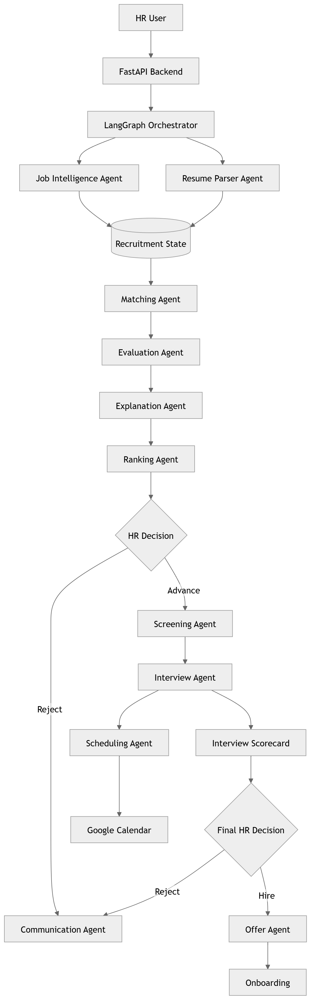

# HERA — AI HR Recruitment Assistant

[](https://fastapi.tiangolo.com)
[](https://react.dev)
[](https://www.postgresql.org)
[](https://www.docker.com)
[](LICENSE)

**HERA (Human-in-the-Loop Evaluator & Recruitment Assistant)** is an enterprise-grade AI recruiting platform designed to streamline and automate high-volume CV screening while guaranteeing that **human recruiters retain ultimate authority over every consequential hiring decision**.

The platform extracts structured candidate profiles from CVs, deterministically calculates match scores against approved job criteria, extracts granular evidence, and provides conversational AI recruitment assistance—with zero hallucinated scoring.

---

## Architecture & System Overview



### Key Architectural Tenet: Human-in-the-Loop & Deterministic Scoring
Unlike naive AI screening tools that ask LLMs to assign arbitrary numbers, HERA strictly decouples **qualitative extraction** from **quantitative scoring**:

1. **LLM Role (Qualitative Only)**: Extracts structured entities from unstructured CV text and evaluates evidence matching (`matched`, `partial`, `missing`) for each specific job requirement.
2. **Python Engine (Deterministic Scoring v1.0)**: Computes the candidate match score (0–100) using locked mathematical weights:
   $$\text{Score} = \frac{\sum (\text{weight} \times \text{evidence\_value})}{\sum (\text{weights of all approved requirements})} \times 100$$
   - **Category Weights**: `must_have = 3`, `important = 2`, `nice_to_have = 1`
   - **Evidence Values**: `matched = 1.0`, `partial = 0.5`, `missing = 0.0`
3. **Recruiter Role (Final Decision Gate)**: The AI presents an evidence bundle and suggested highlights. The HR recruiter makes the binding decision (`advance`, `hold`, or `reject`).

---

## Core Capabilities

- **Automated CV Ingestion & Parsing**: Native text extraction from PDF and DOCX files.
- **Structured Job & Candidate Profiles**: Automatic entity extraction into canonical JSON schemas with versioning and approval workflows.
- **Evidence-Based Matching**: Per-requirement breakdown showing exact evidence snippets from the resume alongside match confidence.
- **Candidate Pool & Talent Pool**: Multi-tiered search, filtering, and cross-organization candidate discovery.
- **Interview Suite**: Full interview lifecycle management, panel selection, scheduling, and structured feedback collection.
- **Adaptive Interview Questions**: Dynamic question generation tailored specifically to candidate skill gaps and requirements.
- **HERA Assistant (Chatbot)**: Conversational assistant utilizing an authorized plan-tool-compose pipeline operating over live recruitment data.
- **Full Observability & Auditing**: End-to-end tracing of all workflow runs, individual pipeline steps, and LLM requests with latency tracking.

---

## Technology Stack

| Layer | Technologies |
| :--- | :--- |
| **Backend** | Python 3.11+, FastAPI, SQLAlchemy 2.0, Alembic, Pydantic v2, Uvicorn |
| **Frontend** | React 19, Vite, React Router v7, Axios, Recharts, Lucide Icons |
| **Database** | PostgreSQL 16 with 11 versioned schema migrations |
| **AI Providers** | Multi-provider abstraction (`FakeAIProvider` for offline deterministic runs, `SoalProvider` / `GeminiProvider` via OpenAI-compatible API) |
| **Infrastructure** | Multi-stage Dockerfiles, Nginx Reverse Proxy, Docker Compose |
| **Tooling** | PowerShell automated runbooks (`tools/`), Pytest, Ruff |

---

## Repository Structure

```text
├── backend/                        # FastAPI application
│   ├── alembic/                    # Database migrations (001_core to 011_chat)
│   ├── app/
│   │   ├── ai/                     # AI contracts, providers, workflows, and tools
│   │   ├── api/v1/                 # REST API endpoints (20+ resource routers)
│   │   ├── core/                   # Application config and database engine
│   │   ├── models/                 # SQLAlchemy ORM models
│   │   └── services/               # Core business and scoring logic
│   ├── tests/                      # Comprehensive test suite (API, units, workflows)
│   ├── Dockerfile                  # Production container definition
│   └── pyproject.toml              # Dependencies and tool configurations
├── frontend/
│   └── frontend_last/              # Canonical React 19 + Vite web client
│       ├── src/
│       │   ├── components/         # Shared UI, Layout, Dashboard, and Chatbot
│       │   ├── pages/              # Jobs, Candidates, Screening, Review, etc.
│       │   ├── services/           # Typed API client services
│       │   └── types/              # Backend API wire contracts
│       ├── Dockerfile              # Multi-stage production build (Node + Nginx)
│       └── nginx.conf              # SPA routing and API reverse-proxy configuration
├── docs/                           # Documentation and references
│   ├── assets/                     # Architecture diagrams and visual assets
│   ├── notes/                      # Historical prompt engineering and roadmap notes
│   ├── references/                 # Service handoff contracts and specifications
│   ├── architecture.md             # In-depth architectural blueprint
│   ├── ai-contract-schema.md       # JSON schemas for AI integrations
│   └── product-requirements.md     # PRD and functional specifications
├── tools/                          # Automated Windows PowerShell runbooks
│   ├── start_backend.ps1           # Launches local FastAPI on :8000
│   ├── start_frontend.ps1          # Launches local Vite client on :5174
│   ├── run_tests.ps1               # Executes test suites
│   └── e2e_screening_flow.py       # Live end-to-end integration test harness
└── docker-compose.yml              # Complete multi-container orchestration
```

---

## Getting Started

### Option 1: One-Command Docker Setup (Recommended)

Run the full stack (PostgreSQL, FastAPI Backend, and Nginx Frontend) with Docker Compose:

```bash
# 1. Clone the repository
git clone https://github.com/Zezoxsaleh/hr-ai-assistant.git
cd hr-ai-assistant

# 2. Copy the root environment file
cp .env.example .env

# 3. Start all services
docker compose up --build -d
```

- **Web Application**: Open [http://localhost:8080](http://localhost:8080)
- **API Documentation**: Open [http://localhost:8000/docs](http://localhost:8000/docs)
- **Health Check**: Open [http://localhost:8000/api/v1/health](http://localhost:8000/api/v1/health)

---

### Option 2: Local Development Setup

#### 1. Database (PostgreSQL)
Ensure Docker is running, then start only PostgreSQL:
```bash
docker compose up -d postgres
```

#### 2. Backend (FastAPI)
```bash
cd backend

# Create virtual environment
python -m venv .venv
# Activate on Windows:
.venv\Scripts\activate
# Activate on Linux/macOS:
source .venv/bin/activate

# Install dependencies in editable mode
pip install -e ".[dev]"

# Configure environment
copy .env.example .env

# Apply database migrations
alembic upgrade head

# Run backend server
uvicorn app.main:app --reload --port 8000
```

#### 3. Frontend (React 19 + Vite)
```bash
cd frontend/frontend_last

# Install dependencies
npm install

# Copy environment configuration
copy .env.example .env

# Start development server
npm run dev
```
Open [http://localhost:5173](http://localhost:5173) in your browser.

---

### Option 3: PowerShell Runbooks (Windows)

Automated scripts are available under `tools/` to manage background instances and logs:

```powershell
# Start FastAPI backend on :8000
.\tools\start_backend.ps1

# Start Frontend client on :5174 connected to local backend
.\tools\start_frontend.ps1 5174 http://localhost:8000/api/v1

# Run the live End-to-End screening validation harness
python tools\e2e_screening_flow.py
```

---

## Environment Variables

### Root / Docker Compose (`.env`)
| Variable | Default | Description |
| :--- | :--- | :--- |
| `POSTGRES_DB` | `hr_ai_assistant` | PostgreSQL database name |
| `POSTGRES_USER` | `hr_ai_assistant` | Database user |
| `POSTGRES_PASSWORD` | `change-me` | Database password |
| `AI_PROVIDER` | `fake` | AI provider (`fake` for offline tests, `soal` for live LLM) |
| `SOAL_API_KEY` | *(empty)* | API key for Soal/OpenAI gateway (required if `AI_PROVIDER=soal`) |
| `SOAL_BASE_URL` | `https://soal.help/api/v1` | LLM Gateway Base URL |
| `SOAL_MODEL` | `gemini-3.5-flash` | Model identifier |
| `FRONTEND_PORT` | `8080` | Host port exposing the React frontend |

### Backend (`backend/.env`)
| Variable | Default | Description |
| :--- | :--- | :--- |
| `APP_NAME` | `AI HR Recruitment Assistant` | Application display name |
| `APP_ENV` | `development` | Runtime environment (`development`, `production`) |
| `DEBUG` | `true` | FastAPI debug mode |
| `API_V1_PREFIX` | `/api/v1` | Prefix for REST endpoints |
| `DATABASE_URL` | `postgresql+psycopg://...` | Connection URI for PostgreSQL |
| `STORAGE_ROOT_DIR` | `./storage` | Directory storing uploaded CV attachments |
| `MAX_UPLOAD_BYTES` | `5000000` | Maximum file upload size limit (5MB) |

---

## Testing & Quality Assurance

Run all test suites and style linters:

```bash
# Backend unit and integration tests
cd backend
pytest

# Code style and formatting checks
ruff check .
ruff format --check .

# Frontend linter and production build verification
cd ../frontend/frontend_last
npm run lint
npm run build
```

---

## Security & Privacy Guidelines

- **No Secrets in Version Control**: `.env` and credential files are strictly excluded via `.gitignore`.
- **Identity Isolation**: Multi-tenant isolation is enforced at the controller and database level using `X-Organization-Id` and `X-User-Id` headers.
- **Untrusted CV Content**: All uploaded files are sanitized and processed in-memory through standard text extractors (`pypdf`, `python-docx`) without executing external macros.

---

## License

This project is licensed under the MIT License - see the [LICENSE](LICENSE) file for details.